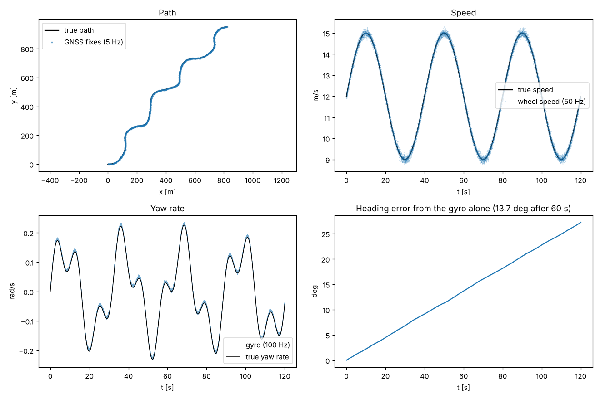

# fusion-fault-lab (v1, built module by module)

Sensor fusion (IMU + wheel speed + GNSS) with fault detection. This repository grows one
module at a time; each module ends in tests that pass.

| Module | Status |
|---|---|
| M1 · Simulator | done |
| M2 · EKF: predict and GNSS update | done |
| M3 · Wheel speed and gyro bias | next |

## M1 · Simulator

`src/fusionlab/sim.py` drives a car along a curving road for 120 s and produces:

| Sensor | Rate | Noise |
|---|---|---|
| Gyro (yaw rate) | 100 Hz | 0.003 rad/s white noise + 0.004 rad/s constant bias |
| Accelerometer | 100 Hz | 0.05 m/s² |
| Wheel speed | 50 Hz | 0.10 m/s |
| GNSS position | 5 Hz | 1.5 m per axis |

The true states (x, y, heading, speed) are kept, so every later module can be measured against them.

```bash
pip install -e ".[dev]"
pytest -q
python scripts/plot_m1.py
```



## M2 · EKF: predict and GNSS update

`src/fusionlab/ekf.py` is a 4-state Extended Kalman Filter, state = [x, y, heading, speed].
The IMU drives the prediction at 100 Hz; each 5 Hz GNSS fix corrects it.
`src/fusionlab/run.py` runs it over a simulated drive and measures it against the truth.

| Case (seed 1) | Position RMSE | Heading RMSE | Mean NIS | Errors within 2σ |
|---|---|---|---|---|
| Raw GNSS, no filter | 2.10 m | – | – | – |
| No gyro bias (the filter's model is right) | 0.26 m | 0.57° | 1.96 | 100 % |
| Bias 0.004 rad/s, honest gyro noise 0.003 | 7.28 m | 4.28° | 25.1 | 12 % |
| Bias 0.004 rad/s, gyro noise inflated to 0.1 | 0.53 m | 1.04° | 1.97 | 99 % |

What it shows: with the right model the filter is 8× better than raw GNSS and *consistent*
(NIS averages its 2 degrees of freedom). An unmodelled gyro bias makes it overconfident and
worse than GNSS. Inflating the gyro noise hides the bias, but only by telling the filter a good
gyro is 33× noisier than it is. M3 fixes it properly by estimating the bias as a 5th state.

```bash
python -m pytest -q
python -m fusionlab.run                 # metrics for seed 1
python -m fusionlab.run --bias 0        # same drive without gyro bias
python scripts/plot_m2.py
```


