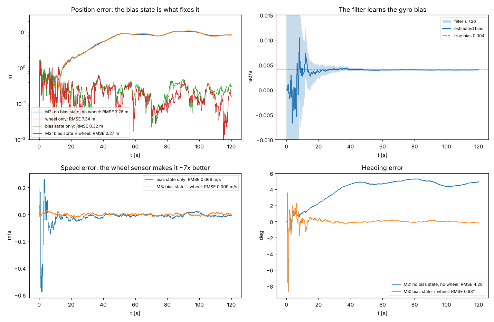

# fusion-fault-lab (v1, built module by module)

Sensor fusion (IMU + wheel speed + GNSS) with fault detection. This repository grows one
module at a time; each module ends in tests that pass.

| Module | Status |
|---|---|
| M1 · Simulator | done |
| M2 · EKF: predict and GNSS update | done |
| M3 · Wheel speed and gyro bias | done |
| M4 · Fault injection and metrics | done |
| M5 · NIS gating and the fault monitor | next |

## M1 · Simulator

`src/fusionlab/sim.py` drives a car along a curving road for 120 s and produces:

| Sensor | Rate | Noise |
|---|---|---|
| Gyro (yaw rate) | 100 Hz | 0.003 rad/s white noise + 0.004 rad/s constant bias |
| Accelerometer | 100 Hz | 0.05 m/s² |
| Wheel speed | 50 Hz | 0.10 m/s |
| GNSS position | 5 Hz | 1.5 m per axis |

The true states (x, y, heading, speed) are kept, so every later module can be measured against them.

```bash
pip install -e ".[dev]"
pytest -q
python scripts/plot_m1.py
```


## M2 · EKF: predict and GNSS update

`src/fusionlab/ekf.py` is a 4-state Extended Kalman Filter, state = [x, y, heading, speed].
The IMU drives the prediction at 100 Hz; each 5 Hz GNSS fix corrects it.
`src/fusionlab/run.py` runs it over a simulated drive and measures it against the truth.

| Case (seed 1) | Position RMSE | Heading RMSE | Mean NIS | Errors within 2σ |
|---|---|---|---|---|
| Raw GNSS, no filter | 2.10 m | – | – | – |
| No gyro bias (the filter's model is right) | 0.26 m | 0.57° | 1.96 | 100 % |
| Bias 0.004 rad/s, honest gyro noise 0.003 | 7.28 m | 4.28° | 25.1 | 12 % |
| Bias 0.004 rad/s, gyro noise inflated to 0.1 | 0.53 m | 1.04° | 1.97 | 99 % |

What it shows: with the right model the filter is 8× better than raw GNSS and *consistent*
(NIS averages its 2 degrees of freedom). An unmodelled gyro bias makes it overconfident and
worse than GNSS. Inflating the gyro noise hides the bias, but only by telling the filter a good
gyro is 33× noisier than it is. M3 fixes it properly by estimating the bias as a 5th state.

```bash
python -m pytest -q
python -m fusionlab.run                 # metrics for seed 1
python -m fusionlab.run --bias 0        # same drive without gyro bias
python scripts/plot_m2.py
```


## M3 · Gyro bias and wheel speed

The filter now has 5 states, [x, y, heading, speed, gyro bias], and a second sensor: wheel
speed at 50 Hz. It subtracts its own bias estimate from every gyro reading.

| Case (seed 1, true bias 0.004 rad/s) | Position RMSE | Speed RMSE | Bias learned | Mean NIS (GNSS / wheel) |
|---|---|---|---|---|
| M2: no bias state, no wheel | 7.28 m | 0.081 m/s | – | 25.1 / – |
| wheel only | 7.34 m | 0.010 m/s | – | 25.6 / 0.97 |
| bias state only | 0.32 m | 0.066 m/s | 0.0040 | 1.96 / – |
| **M3: bias state + wheel** | **0.27 m** | **0.009 m/s** | **0.0040** | **1.96 / 0.97** |

The bias state fixes the position (27× better) and makes the filter honest again (NIS ≈ its
degrees of freedom: 2 for GNSS, 1 for the wheel). The wheel sensor makes speed 7× better. The
bias is learned to within 10 % in 21–27 s, whatever its size or sign.

```bash
python -m pytest -q
python -m fusionlab.run                       # M3
python -m fusionlab.run --no-bias-state       # without the bias state
python -m fusionlab.run --no-wheel            # without the wheel sensor
python -m fusionlab.run --bias 0.01           # a bigger bias
python scripts/plot_m3.py
```



## M4 · Fault injection

`src/fusionlab/faults.py` injects five real sensor failures into the recorded data, with known
start, end and size, while the truth stays untouched. The filter is not told: finding them is
its job from M5 on. `run.py` now also measures the error during and after each fault.

| Fault (scenario) | What it models | RMSE during, mean of 10 seeds |
|---|---|---|
| `gnss_dropout` 40–60 s | tunnel: no fixes | 0.67 m |
| `gnss_jump` 50–56 s, 40 m | multipath near buildings | 9.67 m |
| `gnss_drift` 40–80 s, 1 m/s | receiver error growing slowly | 7.62 m |
| `wheel_scale` 50–70 s, +15 % | wheel slip, wrong tyre radius | 16.54 m |
| `gyro_bias_step` 50–120 s, 0.02 rad/s | IMU bias jump (temperature, shock) | 16.13 m |

Nominal is about 0.3 m. With no fault handling, every fault except the dropout costs 7–17 m,
and the damage lasts well after the fault ends (7.5 m still, 20 s after a 6 s jump). During
each of those four, the NIS jumps from its normal ~2 to 340–730: that is the detector M5 uses.

```bash
python -m pytest -q
python -m fusionlab.run --scenario gnss_jump
python scripts/plot_m4.py
```


