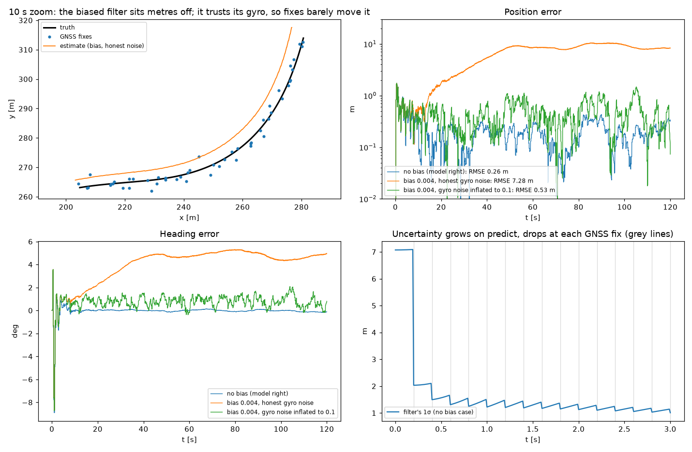
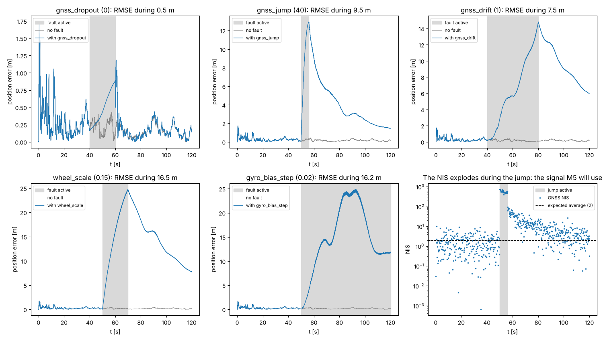
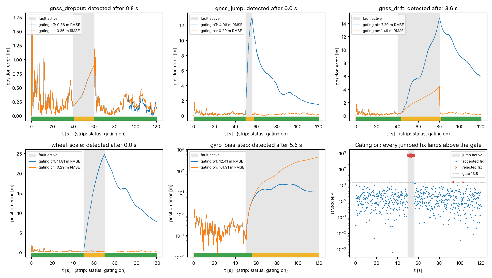
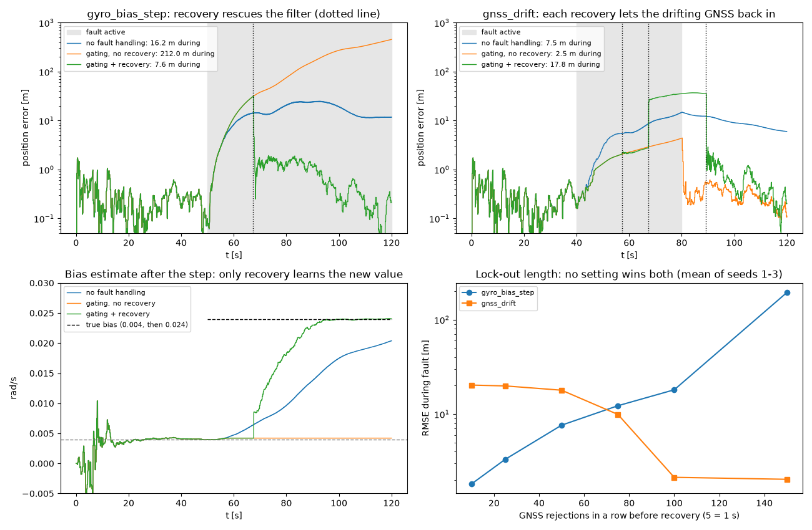

# fusion-fault-lab (v1, built module by module)

[](https://github.com/muhaka-1/fusion-fault-lab-v1/actions/workflows/ci.yml)

Sensor fusion (IMU + wheel speed + GNSS) with fault detection. This repository grows one
module at a time; each module ends in tests that pass.

| Module | Status |
|---|---|
| M1 · Simulator | done |
| M2 · EKF: predict and GNSS update | done |
| M3 · Wheel speed and gyro bias | done |
| M4 · Fault injection and metrics | done |
| M5 · NIS gating and the fault monitor | done |
| M6 · Lock-out recovery and the benchmark | done |
| M7 · C build, test framework, E2E protection | done |
| M8 · CAN messages in C and Python | done |
| M9 · Cluster core: inputs | done |
| M10 · Cluster core: ECU and nav supervision | next |

## M1 · Simulator

`src/fusionlab/sim.py` drives a car along a curving road for 120 s and produces:

| Sensor | Rate | Noise |
|---|---|---|
| Gyro (yaw rate) | 100 Hz | 0.003 rad/s white noise + 0.004 rad/s constant bias |
| Accelerometer | 100 Hz | 0.05 m/s² |
| Wheel speed | 50 Hz | 0.10 m/s |
| GNSS position | 5 Hz | 1.5 m per axis |

The true states (x, y, heading, speed) are kept, so every later module can be measured against them.

```bash
pip install -e ".[dev]"
pytest -q
python scripts/plot_m1.py
```


## M2 · EKF: predict and GNSS update

`src/fusionlab/ekf.py` is a 4-state Extended Kalman Filter, state = [x, y, heading, speed].
The IMU drives the prediction at 100 Hz; each 5 Hz GNSS fix corrects it.
`src/fusionlab/run.py` runs it over a simulated drive and measures it against the truth.

| Case (seed 1) | Position RMSE | Heading RMSE | Mean NIS | Errors within 2σ |
|---|---|---|---|---|
| Raw GNSS, no filter | 2.10 m | – | – | – |
| No gyro bias (the filter's model is right) | 0.26 m | 0.57° | 1.96 | 100 % |
| Bias 0.004 rad/s, honest gyro noise 0.003 | 7.28 m | 4.28° | 25.1 | 12 % |
| Bias 0.004 rad/s, gyro noise inflated to 0.1 | 0.53 m | 1.04° | 1.97 | 99 % |

What it shows: with the right model the filter is 8× better than raw GNSS and *consistent*
(NIS averages its 2 degrees of freedom). An unmodelled gyro bias makes it overconfident and
worse than GNSS. Inflating the gyro noise hides the bias, but only by telling the filter a good
gyro is 33× noisier than it is. M3 fixes it properly by estimating the bias as a 5th state.

```bash
python -m pytest -q
python -m fusionlab.run                 # metrics for seed 1
python -m fusionlab.run --bias 0        # same drive without gyro bias
python scripts/plot_m2.py
```



## M3 · Gyro bias and wheel speed

The filter now has 5 states, [x, y, heading, speed, gyro bias], and a second sensor: wheel
speed at 50 Hz. It subtracts its own bias estimate from every gyro reading.

| Case (seed 1, true bias 0.004 rad/s) | Position RMSE | Speed RMSE | Bias learned | Mean NIS (GNSS / wheel) |
|---|---|---|---|---|
| M2: no bias state, no wheel | 7.28 m | 0.081 m/s | – | 25.1 / – |
| wheel only | 7.34 m | 0.010 m/s | – | 25.6 / 0.97 |
| bias state only | 0.32 m | 0.066 m/s | 0.0040 | 1.96 / – |
| **M3: bias state + wheel** | **0.27 m** | **0.009 m/s** | **0.0040** | **1.96 / 0.97** |

The bias state fixes the position (27× better) and makes the filter honest again (NIS ≈ its
degrees of freedom: 2 for GNSS, 1 for the wheel). The wheel sensor makes speed 7× better. The
bias is learned to within 10 % in 21–27 s, whatever its size or sign.

```bash
python -m pytest -q
python -m fusionlab.run                       # M3
python -m fusionlab.run --no-bias-state       # without the bias state
python -m fusionlab.run --no-wheel            # without the wheel sensor
python -m fusionlab.run --bias 0.01           # a bigger bias
python scripts/plot_m3.py
```


## M4 · Fault injection

`src/fusionlab/faults.py` injects five real sensor failures into the recorded data, with known
start, end and size, while the truth stays untouched. The filter is not told: finding them is
its job from M5 on. `run.py` now also measures the error during and after each fault.

| Fault (scenario) | What it models | RMSE during, mean of 10 seeds |
|---|---|---|
| `gnss_dropout` 40–60 s | tunnel: no fixes | 0.67 m |
| `gnss_jump` 50–56 s, 40 m | multipath near buildings | 9.67 m |
| `gnss_drift` 40–80 s, 1 m/s | receiver error growing slowly | 7.62 m |
| `wheel_scale` 50–70 s, +15 % | wheel slip, wrong tyre radius | 16.54 m |
| `gyro_bias_step` 50–120 s, 0.02 rad/s | IMU bias jump (temperature, shock) | 16.13 m |

Nominal is about 0.3 m. With no fault handling, every fault except the dropout costs 7–17 m,
and the damage lasts well after the fault ends (7.5 m still, 20 s after a 6 s jump). During
each of those four, the NIS jumps from its normal ~2 to 340–730: that is the detector M5 uses.

```bash
python -m pytest -q
python -m fusionlab.run --scenario gnss_jump
python scripts/plot_m4.py
```



## M5 · NIS gating and the fault monitor

Every measurement is now checked before it is used: if its NIS is above the 99.9 % chi-square
value (13.8 for a GNSS fix, 10.8 for wheel speed), it is rejected and the state is left alone.
`src/fusionlab/monitor.py` adds a windowed test (the sum of the last 10 NIS values, for slow
faults that stay under the single-sample gate) and a status: NOMINAL, DEGRADED (no accepted fix
for 1 s, or an alarm) or UNAVAILABLE (the filter's own position σ above 5 m).

| Scenario, mean of 10 seeds | RMSE gating off | RMSE gating on | Detected after |
|---|---|---|---|
| nominal | 0.40 m | 0.41 m | – (0.1 % false rejections) |
| `gnss_dropout` | 0.52 m | 0.52 m | 0.81 s (status DEGRADED) |
| `gnss_jump` | 4.16 m | **0.41 m** | 0.0 s |
| `gnss_drift` | 7.27 m | **1.49 m** | 3.5 s |
| `wheel_scale` | 11.86 m | **0.41 m** | 0.0 s |
| `gyro_bias_step` | 12.33 m | **160.3 m** | 5.2 s |

Gating fixes the step faults completely and limits the drift. It makes the gyro bias step far
worse: once the filter's own heading is wrong, every honest GNSS fix looks like a fault, so it
rejects them all and dead-reckons hundreds of metres away, still reporting only DEGRADED.
That is what M6 fixes.

```bash
pip install -e ".[dev]"                     # scipy is new in M5
python -m pytest -q
python -m fusionlab.run --scenario gnss_jump
python -m fusionlab.run --scenario gnss_jump --no-gating
python -m fusionlab.run --scenario gyro_bias_step
python scripts/plot_m5.py
```



## M6 · Lock-out recovery and the benchmark

In M5 a gyro-bias step locked the filter out: its own heading went wrong, every honest GNSS fix
looked like a fault, and it drifted 450 m away. Now, after 50 GNSS rejections in a row (10 s),
the filter assumes it is the one that is wrong and inflates its position, heading and bias
uncertainty 25× so the gate opens again (`lockout_rejects`, `lockout_inflate` in `EKFConfig`).

`python -m fusionlab.benchmark` runs every scenario in three modes over 10 seeds and writes
`docs/results.md`:

| Scenario (RMSE during fault, mean of 10 seeds) | No fault handling | Gating | Gating + recovery |
|---|---|---|---|
| `gnss_jump` | 9.67 m | 0.28 m | 0.28 m |
| `wheel_scale` | 16.54 m | 0.32 m | 0.32 m |
| `gnss_dropout` | 0.67 m | 0.67 m | 0.67 m |
| `gyro_bias_step` | 16.13 m | 209.85 m | **7.77 m** |
| `gnss_drift` | 7.62 m | **2.42 m** | 17.57 m |

Recovery rescues the gyro case and lets the filter learn the new bias exactly (0.0241 vs 0.024),
but it makes the slow drift 7× worse: after 10 s of rejections it re-opens the gate to a GNSS that
really is drifting, follows it, and reports NOMINAL while 29 m off. Changing the lock-out length
only moves the problem (2 s: gyro 1.8 m, drift 20 m; 30 s: gyro 194 m, drift 2.0 m). From GNSS
innovations alone the filter cannot tell "my heading is wrong" from "GNSS is slowly lying": that
needs a better detector, the first item on the roadmap.

```bash
python -m pytest -q
python -m fusionlab.run --scenario gyro_bias_step
python -m fusionlab.run --scenario gyro_bias_step --no-recovery
python -m fusionlab.run --scenario gnss_drift
python scripts/plot_m6.py
python -m fusionlab.benchmark            # ~2–4 min, writes docs/results.md
```



Phase 1 (the Python estimation core) is complete. Next: the C target.

## M7 · C build, test framework and E2E protection

Phase 2 starts the C target: the code that will run on the Raspberry Pi under QNX. M7 sets up a
CMake build that treats every warning as an error, a minimal test framework (`target/tests/test.h`,
no dependencies), and the end-to-end protection every CAN message will carry:

| Byte | Content |
|---|---|
| 0 | CRC-8 SAE J1850 (poly 0x1D, init 0xFF, xor 0xFF) over the 16-bit message ID and bytes 1–7 |
| 1, bits 0–3 | alive counter 0–14, +1 per frame (15 is never sent) |
| 1, bits 4–7 | free for message flags |

The receiver classifies every frame: `OK`, `OK_SOME_LOST`, `INITIAL` (first frame or resync),
`REPEATED` (sender hung), `WRONG_SEQUENCE`, `BAD_CRC`, `BAD_COUNTER`. Only `OK` and
`OK_SOME_LOST` count as fresh data. Modelled on AUTOSAR E2E Profile 1, simplified, not certified.

```bash
cmake -S target -B target/build                 # add -DSANITIZE=ON on Linux for ASan + UBSan
cmake --build target/build
./target/build/unit_tests                       # 10/10 tests passed
./target/build/e2e_demo                         # every receiver verdict, frame by frame
./target/build/e2e_demo 0x200 5                 # the bytes of 5 protected frames
```

## M8 · CAN messages in C and Python

Every signal in the system travels in one of 11 CAN messages. M8 defines them once
([docs/can_messages.md](docs/can_messages.md)) and implements them twice:

* **C** (`target/include/can_msg.h`, `target/src/common/can_msg.c`): encode and decode for every
  message. This is what the nav node and the cluster core will use.
* **Python** (`src/fusionlab/canbus.py`): the same E2E protection, encoders for what the bench sends
  (sensors, ECU, inputs, nav commands) and decoders for what it reads (nav and cluster output).

Signals are scaled integers, little endian: speed in 0.01 m/s as `u16`, position in cm as a signed
24-bit integer, and so on. Out-of-range values saturate instead of wrapping, and `0xFFFF` means
"no valid value" so the display can draw `--`.

**The contract test.** `target/tools/can_vectors.c` prints one protected frame per message.
Its output is committed as `tests/can_vectors.txt`. Python checks it can produce and read exactly
those bytes, and CI checks that C still prints exactly that file. Change either side alone and a
test fails.

```bash
# C (WSL)
cmake -S target -B target/build -DSANITIZE=ON && cmake --build target/build
./target/build/unit_tests                       # 20/20 tests passed
./target/build/can_vectors                      # the reference frames
./target/build/can_vectors | diff - tests/can_vectors.txt && echo "C unchanged"

# Python (Git Bash or WSL)
python -m pytest -q tests/test_can_contract.py  # 6 tests (1 skipped if C is not built on this OS)
python -m fusionlab.canbus                      # decode every reference frame
python -m fusionlab.canbus 0x200 d437800d39300000
```

## M9 · Cluster core: inputs

The cluster core (`target/src/core/cluster_core.c`) is the only component that decides what the
instrument cluster shows. M9 builds its input side: the stalks and switches arrive as raw levels
from an input board in the INPUTS message (0x210, every 10 ms), and the core turns them into lamps.

| Rule | What | Test |
|---|---|---|
| R1 | every input must be stable for 3 samples (30 ms) before it counts | `debounce_*` |
| R2 | hazard toggles on the debounced press, not while held; hazard overrides the stalk | `hazard_*` |
| R3 | stalk left and right at once is implausible: no indicator | `both_stalk_contacts_is_implausible` |
| R4 | indicators blink 90 times a minute, half on, half off, and start lit | `blink_*`, `*indicator*` |
| R5 | main-beam lamp only with dipped beam on, or while flash is held | `beam_logic` |
| R10 | no usable INPUTS frame for 100 ms: INPUT FAULT, all input lamps off | `input_board_loss_*`, `corrupted_input_*` |

All rules: [docs/cluster_rules.md](docs/cluster_rules.md). Gauges and heading stay `--` until M10
brings the ECU and nav data.

**Time is a parameter.** The core never reads a clock: every call gets `now_ms`. The tests use a
fake bench with its own clock, so 4 seconds of blinking run in microseconds and give the same
result every time.

```bash
# WSL
cmake -S target -B target/build -DSANITIZE=ON && cmake --build target/build
./target/build/unit_tests                       # 36/36 tests passed
./target/build/cluster_sim                      # timing diagram of the built-in demo
./target/build/cluster_sim 0:- 200:L 2000:-     # your own script: TIME_MS:SWITCHES
```

`cluster_sim` switches: `L` left, `R` right, `H` hazard, `D` dipped, `M` main beam, `F` flash,
`-` nothing, `X` the input board goes silent, `~` prefix: the contacts bounce for 20 ms.
